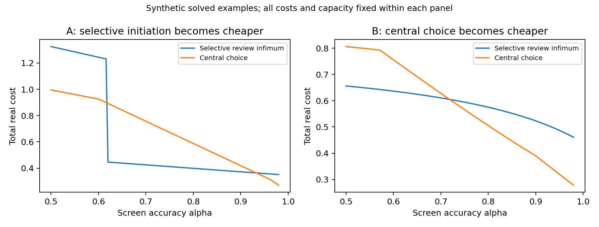

# 1. Introduction

Information at headquarters can substitute for local judgment, but it can also make a local proposal process more credible. The distinction is not resolved by counting dashboards or observing a change in hierarchy. A manager may retain the right to initiate a project while headquarters corrects more proposed actions. The same records may show fewer proposals, more local final decisions including abstention, and fewer locally implemented positive actions. Each statement describes a different margin.

This paper asks when better central screening changes the preferred assignment of rights after local managers rationally adjust their proposals. The first benchmark treats one heterogeneous decision opportunity in a large flow; the finite extension treats two independent opportunities sharing exactly one non-storable slot. A manager knows whether implementation creates firm value and how much private benefit implementation supplies. Headquarters sees a noisy risk statistic, can spend a review slot to run an imperfect detection test, and may stop the proposed action if the test detects a bad project. The review rule is chosen before proposals, and the manager anticipates it.

The completed contribution combines a tractable population screening benchmark with a finite-batch implementation boundary. In the finite game, redeployment after filings raises the feasible complete-deterrence frontier but makes bad filing strategically complementary. Every filing equilibrium is characterized, and an all-rule obstruction prevents full implementation at an uninformative witness. Target costs are solved separately from robust welfare. In the population benchmark, all equilibria of the local proposal subgame are characterized, including indifference and off-path deviations. Optimal review reduces to an explicit frontier connecting bad-project scrutiny, good-project scrutiny and capacity reservation. The loss-minimizing policy is obtained from a finite set of candidates, not an assumed relation between information quality and review availability. Better screening shifts a deterrence capacity threshold; discontinuous changes in the proposal pool can then change the preferred governance regime.

Several negative results limit the interpretation. A costless proposal that offers a strictly positive chance of private benefit cannot be deterred without a penalty. When all bad managers have the same temptation, robust deterrence removes all bad proposals and hence removes all on-path replacements. Moreover, a central institution that can costlessly reproduce every local proposal rule cannot be strictly worse than that rule. The population governance-switch examples therefore require actual proposal preparation costs, heterogeneous temptations for partial deterrence, and an institutional difference in processing costs or feasible decision paths. The finite extension needs only one bad benefit type; its separate issue is congestion and multiplicity, not a claim that complete deterrence produces on-path correction. Those primitives are fixed when information quality improves. They are stated as requirements, not inferred facts about firms.

The former quadratic comparison is retained only as a benchmark in Appendix B. Its signs follow partly from allocating each signal to the regime in which it is useful. It is not presented as the original theoretical contribution. The former independent-oracle-review extension has been removed. The new model endogenizes proposal behavior; it does not also endogenize information acquisition or solve all organizational mechanisms.

# 2. Closest results and contribution

Aghion and Tirole (1997) already model the feedback from intervention to initiative: information-acquisition effort depends on the likelihood of retaining effective control. Their principal can overrule when informed, and their analysis also includes contingent delegation and scarce attention. Our endogenous object is submission of an already known opportunity, rather than effort to discover projects. We study an imperfect screening/test process under a reserved-capacity rule. Neither the formal/real authority distinction nor the idea that intervention changes initiative is new here.

Alonso, Dessein and Matouschek (2008) study two interacting decisions and endogenous cheap-talk communication under central and decentralized authority. Authority changes incentives to distort messages; coordination changes horizontal and vertical communication differently. Our binary submission decision is not that communication equilibrium. We impose commitment to testing and no unverified override, rather than solve costless message partitions. We include their corrigendum in the bibliography. Its full text remained behind the AEA access route; no corrected equation is reproduced or used in our proofs.

Habermacher (2025) is a close predecessor for information, authority and specialization. The published abstract describes endogenous acquisition of noisy information about two states and the communication benefits of specialization. The inspected May 2022 working version develops a multidimensional cheap-talk mechanism in which restricting what an agent observes changes available deviations. Our mechanism instead selects which costly tests are reserved for binary submissions and makes the submission pool endogenous. This is a comparison to mechanisms actually inspected, not certification that the final article omits our result. The requested publisher full-text URL repeatedly redirected to its abstract; PDF routes and the author-linked preprint were inaccessible. A final-text, theorem-by-theorem comparison remains an outstanding literature objection.

Argenziano, Severinov and Squintani (2016) analyze costly sampling followed by strategic advice. In the inspected final-submission version, overt acquisition can be disciplined through off-path communication and covert acquisition through the inflexibility of the communication language. Here the sampling technology is fixed, and commitment disciplines submission directly. We do not claim to extend their acquisition-effort result.

Halac and Yared (2020), final published version, study a biased informed agent choosing spending under a principal's committed delegation rule. The rule specifies allowable spending after the agent's verification request and its result; verification perfectly reveals type and incurs an additive cost. Their main analysis uses deterministic verification. Low verification costs support a threshold with an escape clause; higher costs can support an interior verification region. Their limited-commitment case permits revision of the spending set after verification, but retains commitment to honor verification requests (Sections II, IV-VI). Our Proposition 4(c), which removes commitment to testing itself, is therefore a different boundary. Our binary filing game with a private noisy risk screen, imperfect detection and reserved slots does not extend their optimal delegation-set theorem. Selective verification and its incentive role are prior results.

Erlanson and Kleiner (arXiv:2409.02031v1, Sections 2-4, Theorem 1) already impose ex-post allocation and audit capacity at every report profile and lottery realization, with perfect verification and no incremental testing cost. Their interim IC is $A(t)\geq P(t)-\inf P$. Their optimal merit-with-guarantee rule combines high-report allocation with a residual lottery guaranteeing low types an allocation chance; implementing the interim rules under the hard constraints is part of their result. These mechanisms and capacity principles are inherited, not contributions here. Our population reservation differs from their hard capacity; Section 8 now uses hard capacity. Its added bounded result concerns costly filing, imperfect detection and filing-dependent audit congestion: fewer filings redeploy a slot, changing bad-type incentives and allowing multiple strict BNE. The resulting target-versus-full-implementation distinction is not their object-allocation theorem. The retrieved version-specific HTML bears an August 2026 body date despite the v1 identifier and 2024 submission metadata; we identify the inspected text without claiming final publication or that it is an immutable 2024 snapshot. Habermacher's inaccessible final theorems are not asserted absent.

The population contribution is the explicit reservation threshold $K>\pi\gamma_\alpha(t_i)+(1-\pi)t_i$ for strict deterrence, coupled with a complete finite-branch value and attainment characterization under worst-response tie selection. The likelihood-ratio ranking and minimization of piecewise affine functions are standard arguments, not new general results. Our formula combines those tools with imperfect detection, costly binary filing and heterogeneous private temptations. At a deterrence threshold an indifferent type still files under worst selection, so a lower-loss right-hand limit need not be attained. That specific open-boundary distinction is proved in Theorem 3 and Appendix A3; it is not a claim that nonattainment in mechanism design is new. Neither predecessor's headline result establishes this particular reserved-slot threshold for our game, and ours does not solve their richer mechanisms. The finite-batch contribution is the exact pair of complete-deterrence frontiers over arbitrary rules, the full filing-equilibrium correspondence, the all-rule obstruction at the witness, and the finite-candidate target-cost characterization. No first audit-capacity, first likelihood-ratio or first initiative/intervention claim is made.

The empirical motivation remains consistent with the differing analytics associations studied by Labro, Lang and Omartian (2023) and Wu, Lou and Hitt (2019), and with Bloom et al.'s (2014) distinction between information and communication technology. Those studies do not supply observations for this paper. The contribution claimed here is the exact solution and boundaries of the stated small game, plus its discriminating measurement implications. Whether that combination is sufficiently original for a journal remains open, particularly given the incomplete final Habermacher comparison.

# 3. A strategic proposal and testing game

## 3.1 Opportunities, preferences and real costs

A flow of opportunities has three private types. With probability $\pi\in(0,1)$ the opportunity is good, denoted G. With probabilities $(1-\pi)\lambda$ and $(1-\pi)(1-\lambda)$ it is bad, denoted B1 and B2, where $\lambda\in(0,1)$. The manager observes the type. Headquarters knows the prior but not its realization.

The final action is $a\in\{0,1\}$, meaning abstain or implement. Relative to the full-information action, firm decision loss is $V>0$ for rejecting a good opportunity, $H>0$ for implementing a bad one, and zero otherwise. The parameter H can include downstream coordination losses. It is not an equilibrium model of cross-unit resource choices.

A good manager obtains private payoff $Va$; a bad manager of class i obtains $b_i a$, with $0<f<b_1<b_2$ and $V>f$. Filing a positive proposal costs the manager f in preparation effort and also consumes f units of real firm resources. This is the same physical labor cost viewed by the manager and the firm, counted once in firm loss. Private benefits $b_i$ are not added to firm value. A test costs c units of real firm resources, including labor and monetized test-induced delay. Headquarters processing under the centralized path costs an additional d per opportunity. We assume $c>0$, $d\geq0$ and do not vary them when changing information accuracy.

The social value of private benefits, worker distributional effects and privacy are outside the objective. All welfare comparisons below mean firm loss plus the stated real resource costs.

## 3.2 Noisy access and imperfect verification

Headquarters has a binary risk statistic $s\in\{H,L\}$ with accuracy $\alpha\in[1/2,1)$:

$$P(H\mid B_i)=\alpha,\qquad P(H\mid G)=1-\alpha.$$

The statistic has the same conditional distribution for B1 and B2. It is private to headquarters and is not revealed to managers before filing. Increasing $\alpha$ is a Blackwell improvement in this symmetric binary experiment. Nothing else changes.

A paid test detects a bad opportunity with probability $\zeta\in[0,1]$ and never falsely detects a good opportunity. Detection is independent of the screening signal conditional on quality. A detected bad proposal is replaced by abstention. A negative test does not certify quality; with $\zeta<1$ bad projects can pass. The main examples use $\zeta=0.9$, not an oracle. The center's central-choice benchmark updates correctly after a negative test.

## 3.3 Governance, commitment and capacity

Headquarters chooses among the following paths before type and screening realizations:

-   D0: a standing prohibition on implementation. No filing or testing occurs and loss is $\pi V$.

-   D1: permission for local implementation without review. A positive local decision requires filing the same operational proposal. All types file and loss is $f+(1-\pi)H$.

-   C: central choice from s, with optional testing, no local proposal process and overhead d per opportunity. The center chooses optimally between implementation and abstention before or after testing.

-   S: local positive proposals with selective testing. A manager chooses $m\in\{0,1\}$. If $m=0$, action is zero and no test occurs. If $m=1$, the center tests with probabilities $q_H,q_L\in[0,1]$ conditional on s. Without detection, the proposal is implemented. The rule and its lottery are binding. No unverified central override is permitted in S.

D0 and D1 are the optimal choices within the binary unreviewed-delegation class. S includes D1 at $q_H=q_L=0$. C is optimal within signal-only central choice, not within every possible centralized institution that might also solicit strategic reports. This menu reflects different operational paths and must not be confused with unrestricted mechanism design.

For S define

$$Q_B=\alpha q_H+(1-\alpha)q_L,\qquad
Q_G=(1-\alpha)q_H+\alpha q_L.$$

A service-level constraint reserves enough review slots even if every opportunity is submitted:

$$\pi Q_G+(1-\pi)Q_B\leq K,\qquad 0\leq K\leq1. \tag{1}$$

K is the fraction of opportunities for which test capacity can be reserved. Actual tests may be fewer after deterrence. Reservation protects the announced deadline against strategic submission changes; idle reservations are not reallocated after messages. The fixed cost of the existing review team is common across paths and omitted; c is the incremental cost of a test. This is a specific capacity protocol. It is stronger than an equilibrium-load constraint and is not the optimal contingent allocation of scarce slots in a finite batch. One can interpret fractions as exact masses in a nonatomic flow, or as long-run service reservations. This population benchmark makes no finite-batch hard-capacity claim; Section 8 separately solves a two-opportunity, one-slot game with contingent redeployment.

Write reserved capacity as $R=\pi Q_G+(1-\pi)Q_B$ and equilibrium workload as $J=\pi Q_G+BQ_B$. Their exact gap is

$$R-J=[(1-\pi)-B]Q_B\geq0.$$

It is zero when every bad opportunity is submitted, and positive when deterrence removes bad submissions and Q_B\>0. Replacing (1) with J$\leq K$ changes the feasible set endogenously with B; the threshold (4) would then no longer follow from our proof. At a fixed target Q, the analogous workload expression is $\pi\gamma_\alpha(Q)+BQ$, but using it to redesign the mechanism requires another optimization problem, which we do not undertake. In Example A after improved screening, R=0.300 and J=0.111, a gap of 0.189. These are not interchangeable measures of scarce capacity.

The timing is: choose path and commit q; the manager learns type; headquarters observes s privately; the manager files or abstains without observing s; the committed lottery selects tests; detection and action occur. The manager knows q and its conditional test probabilities. There are no fines, contingent transfers or quality certificates supplied freely by managers. Extra unverified assertions do not alter the committed action or test rule. A quality report is not assumed credible.

This commitment is consequential. Even if submitted proposals are good in equilibrium, the center must honor a promised test. We later show why complete deterrence generally fails without that commitment. We also state what disappears if centralized institutions can replicate S costlessly.

# 4. Equilibrium and the exact selective-review solution

## Theorem 1. Every local equilibrium response

For any feasible q in S, good managers strictly file. Bad type i files if

$$b_i(1-\zeta Q_B)-f>0,$$

abstains if that expression is negative, and may use any filing probability $p_i\in[0,1]$ if it is zero. For $\zeta>0$ define

$$t_i=\frac{1-f/b_i}{\zeta},\qquad 0<t_1<t_2.$$

Thus $p_i=1$ for $Q_B<t_i$, $p_i=0$ for $Q_B>t_i$, and every mixture is a best response at $Q_B=t_i$. If $t_i>1$, that type can never be deterred. If $\zeta=0$, all types file regardless of q.

Let the mass of submitted bad opportunities be

$$B=(1-\pi)[\lambda p_1+(1-\lambda)p_2].$$

For every equilibrium, actual review, replacement and total loss are

$$J=\pi Q_G+BQ_B,\qquad M=\zeta BQ_B,$$

$$L_S=f(\pi+B)+c(\pi Q_G+BQ_B)+HB(1-\zeta Q_B). \tag{2}$$

These formulas apply also to mixed equilibria at thresholds. Conditional on a proposal and signal s, the posterior bad probability is $B w_B(s)/[\pi w_G(s)+B w_B(s)]$, where $w_B=(\alpha,1-\alpha)$ and $w_G=(1-\alpha,\alpha)$. With no proposals from bad types, this posterior is zero. Off-path positive proposals from a deterred type face exactly the promised test rule; their deviation payoff is the expression above. Good-type abstention yields zero instead of $V-f>0$. No favorable off-path belief is needed because actions are committed.

## Theorem 2. The capacity-deterrence frontier

Fix a desired bad-type review probability $Q\in[0,1]$. Among all rules with $Q_B=Q$, the smallest good-type review probability is

$$\gamma_\alpha(Q)=
\begin{cases}
(1-\alpha)Q/\alpha,&0\leq Q\leq\alpha,\\
1-\alpha+\alpha(Q-\alpha)/(1-\alpha),&\alpha\leq Q\leq1.
\end{cases} \tag{3}$$

It is implemented by reviewing high-risk proposals first: $q_H=Q/\alpha,q_L=0$ for $Q\leq\alpha$, and $q_H=1,q_L=(Q-\alpha)/(1-\alpha)$ otherwise. At $\alpha=1/2$ all rules give $Q_G=Q_B$ and the same frontier value.

Consequently the minimum reserved capacity for Q is

$$\kappa_\alpha(Q)=\pi\gamma_\alpha(Q)+(1-\pi)Q. \tag{4}$$

A bad type with $t_i<1$ can be strictly deterred if and only if $K>\kappa_\alpha(t_i)$. If $t_i\geq1$, strict deterrence is impossible. For fixed $Q\in(0,1)$, $\kappa_\alpha(Q)$ is continuous and strictly decreases as accuracy rises above one half; it can have an accuracy kink at $\alpha=Q$. Better central access therefore lowers the capacity threshold for deterrence, rather than exogenously increasing review availability.

Write $m_H=\pi(1-\alpha)+(1-\pi)\alpha$. The largest feasible Q is

$$\bar Q=
\begin{cases}
\alpha K/m_H,&K\leq m_H,\\
\alpha+(1-\alpha)(K-m_H)/(1-m_H),&K\geq m_H.
\end{cases} \tag{5}$$

Within any fixed submission branch, replacing a rule by the frontier rule with the same Q weakly reduces cost and capacity use. For $c\pi>0$ and $\alpha>1/2$, non-frontier review cannot be strictly optimal at a fixed Q.

## Theorem 3. Global value from finitely many candidates

Use worst-equilibrium selection for indifference: when a bad type is indifferent, it files. This maximizes firm loss among that type's best responses because its incremental cost contribution is strictly positive. The three branches have remaining bad mass

$$B_0=1-\pi,\qquad B_1=(1-\pi)(1-\lambda),\qquad B_2=0.$$

Their actual domains are $[0,t_1]$, $(t_1,t_2]$ and $(t_2,1]$, intersected with $[0,\bar Q]$. Empty branches are discarded, including a branch whose lower threshold equals $\bar Q$ and cannot be crossed. A threshold above one is treated as unreachable, not clipped into a spurious deterrence branch.

On branch j the frontier cost is

$$\ell_j(Q)=f(\pi+B_j)+c\pi\gamma_\alpha(Q)+(c-H\zeta)B_jQ+HB_j. \tag{6}$$

It is piecewise affine, with its only interior kink at $Q=\alpha$. Its infimum is the minimum at the two endpoints of the branch closure and at $\alpha$ if that point lies in the closure. Taking the minimum across nonempty branches gives the global worst-equilibrium cost infimum $\underline L_S$. At a lower deterrence threshold, the value on the branch to its right is a one-sided limit, not necessarily attained. An optimal rule exists if and only if some minimizing point belongs to its actual branch domain. If all minimizers are excluded lower endpoints, only an infimum exists; rules immediately to their right approach it with strict deterrence.

For implementation one can instead impose a known strict incentive margin $\eta>0$: require Q to stay at least $\eta$ away from both reachable thresholds. Each resulting branch is compact, has a unique submission pattern, and is solved by the same endpoint-and-kink calculation. This is a robustness restriction, not an equilibrium refinement hidden in the analysis. Our two examples attain the unrestricted worst-equilibrium optimum away from all thresholds and remain unchanged at $\eta=0.001$.

Theorem 3 solves the full continuous selective-rule problem in this menu. It neither assumes truthful proposals nor substitutes a fixed risk ranking for incentive compatibility. The ranking, participation thresholds and feasible capacity are derived jointly. The finite-candidate calculation is also more informative than an unexplained parameter sweep: it identifies every possible source of a policy switch.

## 4.1 The central-choice benchmark on the same cost basis

For each s let $g_s=\pi w_G(s)$, $b_s=(1-\pi)w_B(s)$ and $m_s=g_s+b_s$. Without testing, the minimum unconditional contribution to decision loss is $e_s=\min\{g_sV,b_sH\}$. With a test it is

$$a_s=cm_s+\min\{g_sV,(1-\zeta)b_sH\}.$$

A positive detection leads to rejection. Following no detection, headquarters updates and either accepts or rejects. Thus C does not pretend that a negative test reveals a good type. With $r_s\in[0,1]$ the central test probability,

$$L_C=d+\min_{r}\sum_s[e_s+(a_s-e_s)r_s]
\quad\text{s.t. }\sum_s m_sr_s\leq K. \tag{7}$$

The solution tests only signals with positive net benefit $e_s-a_s$, in descending order of $(e_s-a_s)/m_s$, stopping when capacity is exhausted or further testing is unprofitable. It is a two-item fractional-knapsack problem. D0 and D1 have losses stated above, so governance is ranked by $\min\{\pi V,f+(1-\pi)H,L_C,\underline L_S\}$, respecting possible nonattainment of S. Test cost c, filing cost f and central processing cost d all enter the same firm objective.

# 5. Boundaries, commitment and comparative statics

## Proposition 4. What screening cannot accomplish

1.  If $f=0$, $b_i>0$, $\alpha<1$ and $K<1$, no bad type can be strictly deterred. If $\zeta<1$ the same impossibility holds even at full capacity. A real filing cost, a bounded penalty or a genuine cost of a rejected proposal is needed for strict deterrence in this binary game.

2.  With a single bad private-benefit type and away from indifference, any deterrent equilibrium has $B=0$ and hence $M=0$. Robust partial deterrence combined with positive replacement requires heterogeneity of temptation, imperfect local knowledge, or another source of a residual submitted bad pool. Our examples use two temptations. Mixing at a knife-edge can also leave a residual pool but is not a robust explanation.

3.  If the principal cannot commit to costly testing, a complete-deterrence equilibrium with positive testing is not sequentially rational. On-path submissions are all good, so any positive-cost test has no decision value. Canceling testing makes bad submissions profitable. This does not prove that partial deterrence is impossible without commitment; the present paper solves the committed game only.

4.  If a centralized institution can use the same messages and tests as S, commit to the same default actions, and do so with no additional real cost or capacity requirement, its feasible set includes S. It cannot be strictly worse than S. Therefore a strict preference for delegated initiation requires non-nesting of feasible policies or a real processing/commitment cost difference. The positive d in our examples is fixed, not generated by better data. Our central benchmark is signal-only; an enriched institution soliciting strategic reports is outside the solved menu.

These boundaries prevent two overclaims. The examples do not establish that all optimal organizations decentralize as data improve. Nor does the menu comparison prove that local formal authority has value over an unrestricted center. What is established is how strategic submissions and a measurable reserved-capacity frontier alter the ranking of specified operational paths.

## Proposition 5. Better information and nonmonotone rights

Both the optimal central-choice value and the selective-review cost infimum weakly improve when $\alpha$ rises, because the improved binary signal can be garbled to reproduce the original experiment. This leaves both conditional review probabilities, every manager's incentives and reserved capacity unchanged. Information has no negative firm value under commitment and optional use in this model.

Rights need not move monotonically. On a capacity-binding high-risk-only segment, $q_H=K/m_H<1$, $q_L=0$,

$$\frac{dQ_B}{d\alpha}=\frac{K\pi}{m_H^2}>0,\qquad
\frac{dQ_G}{d\alpha}=-\frac{K(1-\pi)}{m_H^2}<0. \tag{8}$$

With remaining bad mass B fixed, replacement $M=\zeta BQ_B$ rises. At a deterrence threshold B falls discretely and replacement can fall instead. Better screening can thus improve outcomes while increasing, decreasing or discontinuously changing recorded interventions. The direction of the governance switch is determined by the solved cost comparison, not equation (8) alone.

# 6. Strictly implemented synthetic examples

All quantities in this section are constructed, uncalibrated examples of the solved game. They are not firm observations. Each optimum is checked by polygon vertex enumeration, a separate linear-program solver, a scalar frontier calculation, and enumeration of type/signal/test events. Deviation gains are in the reproduction output.

## 6.1 Central data expand initiation and realized replacement

Fix $\pi=0.5$, $\lambda=0.7$, $H=3$, $V=2$, $f=0.2$, $b_1=0.3$, $b_2=1.2$, $c=0.1$, $d=0.22$, $K=0.3$ and $\zeta=0.9$. Only $\alpha$ changes, from 0.55 to 0.90. Both thresholds are interior in principle: $t_1=10/27\simeq0.37037$ and $t_2=25/27\simeq0.92593$.

::: longtable
@ \>p(- 10) \* \>p(- 10) \* \>p(- 10) \* \>p(- 10) \* \>p(- 10) \* \>

p(- 10) \* @

Accuracy

&

S minimum cost

&

C minimum cost

&

D0 cost

&

D1 cost

&

Chosen path

\
& 1.2845 & 0.9605 & 1.0000 & 1.7000 & C\
0.90 & 0.3724 & 0.4190 & 1.0000 & 1.7000 & S\
:::

At both selective optima the rule is $q_H=0.6,q_L=0$, using exactly 0.3 reserved capacity. At low accuracy $Q_B=0.33<t_1$, so every bad opportunity is submitted. At high accuracy $Q_B=0.54$ lies strictly between the thresholds. B1 managers abstain, B2 managers file, and B falls from 0.5 to 0.15. Actual reviews in S fall from 0.300 to 0.111 even though reserved capacity is unchanged.

The high-accuracy deviation payoff of a B1 filing is $0.3(1-0.9\cdot0.54)-0.2=-0.0458$. The B2 filing payoff is $1.2(1-0.9\cdot0.54)-0.2=0.4168$. Good filing yields $2-0.2=1.8$. All responses are strict. Under the chosen low-accuracy C path there is no local initiation right and no replacement of a local proposal. After the switch to S, the right to initiate is granted, 0.65 proposals are filed per opportunity, and 0.0729 proposals per opportunity are centrally replaced. Thus delegated initiation and actual central replacement both rise across the optimal path switch.

This is not a claim that replacement rises within S: it falls from 0.1485 to 0.0729 across the two counterfactual S policies because deterrence changes the pool. Nor are all 0.65 proposals locally finalized. Only 0.539 positive actions are implemented without testing. Including local abstentions, 0.889 opportunities end without central review. These are separate measurements.

## 6.2 Central data reduce local final choice

Fix $\pi=0.8$, $\lambda=0.5$, $H=3$, $V=1$, $f=0.1$, $b_1=1$, $b_2=2$, $c=0.1$, $d=0.25$, $K=0.1$ and $\zeta=0.9$. Change only $\alpha$ from 0.55 to 0.95.

::: longtable
@ \>p(- 10) \* \>p(- 10) \* \>p(- 10) \* \>p(- 10) \* \>p(- 10) \* \>

p(- 10) \* @

Accuracy

&

S minimum cost

&

C minimum cost

&

D0 cost

&

D1 cost

&

Chosen path

\
& 0.646809 & 0.796809 & 0.800000 & 0.700000 & S\
0.95 & 0.486957 & 0.320000 & 0.800000 & 0.700000 & C\
:::

No bad type can be deterred under the available capacity: $t_1=1$, $t_2>1$. Screening still improves the selective path, but the central path improves more. The selected policy switches from S with 0.9 unreviewed local positive actions per opportunity to C with no local final choice. More precise information has value in both regimes while rights centralize.

# 7. Rights and discriminating empirical measurements

The model distinguishes the right to initiate, actual filing, central review, replacement, local final choice and escalation. In S the initiation right is one; in C it is zero. The filing rate is P=$\pi+B$ in S. Testing J is an exercise of a contingent prior veto right; effective veto/replacement M occurs only when a bad proposal is detected. Tested proposals that pass are centrally reviewed, not locally final merely because their action is unchanged.

Two denominators are necessary. Local final positive implementation per opportunity is $F_+=P-J$. Local final dispositions including abstention are $F_{all}=1-J$ in S, because unsubmitted opportunities end locally at zero. These are not interchangeable. Conditional rates among submitted proposals are $J/P$ and $M/P$. In C local final choice is zero by institutional definition, although headquarters may choose the same action a local manager would have chosen. Escalation to a third decision maker is absent from this model, so its predicted rate is zero, not an unidentified relabeling of review.

The new mechanism's discriminating observations are the pre-filing risk signal and who can see it; the committed test probabilities and actual compliance; capacity reserved versus tests used; submission and withdrawal before review; filing effort; test sensitivity and false-positive performance; and whether lower-temptation opportunities disappear from the proposal pool. One must record all eligible opportunities, not just submissions. A fall in replacement with higher screening precision can reflect deterrence rather than weak monitoring. Conversely, more corrections do not demonstrate greater local final authority.

Conditional-MSE first stages remain useful for the original information-location benchmark in Appendix B. For this binary model the analogous first stage is calibration and discrimination of $P(B\mid s,\mathcal I_0)$ relative to existing information $\mathcal I_0$. Verify the improvement among an independently sampled opportunity set, including unsubmitted cases; observing only tested proposals creates verification bias. Random validation tests or authorized external quality outcomes are needed to estimate signal and detection accuracy. Local private benefits are latent; incentive proxies do not identify their distribution without further assumptions.

Appendix C retains two feasible modules: an access-by-access experiment with endogenous authority, and a separate local-access-by-assigned-authority experiment with central access held fixed. No experiment has run. Access is not an instrument for authority because it directly affects performance under fixed authority. A targeted follow-up could compare two committed screening protocols under one access rollout, with enough independent approval networks and a pre-specified first stage. It does not require eight cells, and the present package promises no field execution.

# 8. Two opportunities and one non-storable audit slot

## 8.1 A different physical capacity protocol

This section replaces neither the population benchmark nor its capacity definition. A batch contains two independent opportunities, one per manager. Each is good with probability $\pi\in(0,1)$ and bad otherwise. There is one bad benefit b, with $0<f<b$, and $V>f$. The private payoff is $V-f$ for filing a good project, $b a-f$ for filing a bad project implemented with indicator a, and zero for abstention. The real batch loss is filing effort plus tests plus bad-implementation harm: $f E[N_F]+c E[N_T]+H E[N_{BI}]$. Good projects always file and are never falsely rejected, so their foregone value is zero in every equilibrium. Private b is not a real resource loss. Costs f and c are counted once.

Headquarters observes two private binary risk signals, each with accuracy $\alpha\in[1/2,1]$, independently conditional on qualities. Managers know their own quality but observe neither signal, the peer's type, nor assignment or lottery realizations before simultaneously filing. Headquarters commits before types. A tested bad filer is detected with probability $\zeta\in(0,1]$; no good filer is detected. Every filed project is implemented unless bad detection occurs. There are no transfers, penalties beyond rejection, or unverified overrides. Only one test can occur at every on- and off-path history and every lottery realization. The slot cannot be stored. Test assignment precedes any test outcome, so there is no second test after nondetection. The analysis conditions on this commitment; no new commitment device is assumed.

We compare two rules on these same primitives and the same physical slot. A **fixed assignment** chooses none, manager 1, or manager 2 after both signals but before filings, and wastes the slot if its recipient abstains. A **recourse rule** assigns after both signals and filings, allowing a sole filer to receive the slot. The old population reservation constraint is neither rule.

Write $w_B=(\alpha,1-\alpha)$ and $w_G=(1-\alpha,\alpha)$ for high/low risk probabilities, and $m=\pi w_G+(1-\pi)w_B$. A fixed rule has probabilities $a_i(s_1,s_2)\geq0$, $a_1+a_2\leq1$. A recourse rule has sole-filer probabilities $u_i(s)\in[0,1]$ and both-filer probabilities $v_i(s)\geq0$, $v_1(s)+v_2(s)\leq1$, at each of four signal pairs s. With neither filing, no test occurs. These inequalities are necessary and sufficient for hard feasibility: at each history draw none or exactly one recipient with the stated probabilities. All subsequent probabilities refer to such lotteries, never to independent Bernoulli tests that could exceed capacity.

## Theorem 6. Complete-deterrence frontiers over all assignments

Let $t=(1-f/b)/\zeta$. The largest achievable common bad-deviation test probability, when both bad types abstain and good types file, is

$$Q_F=\tfrac12+\pi(\alpha-\tfrac12)\quad\text{under fixed assignment},$$ $$Q_R=1-\pi+\pi\alpha\quad\text{under recourse}.$$

These maxima hold over arbitrary randomized, asymmetric rules. Complete bad abstention is a strict BNE if and only if $t<Q_F$ or $t<Q_R$, respectively. Equality permits weak but not strict complete deterrence. If t exceeds the corresponding maximum, even weak complete deterrence is impossible. Higher-risk-first assignment with fair ties attains each frontier; recourse also tests a sole filer with probability one. The frontier increase is $Q_R-Q_F=(1-\pi)/2>0$. This is a target-equilibrium feasibility result, not uniqueness or full implementation.

## Theorem 7. Every filing equilibrium, including asymmetry and equality

For a fixed rule define

$$q_{iB}=\sum_s w_B(s_i)m(s_j)a_i(s),\qquad j\ne i.$$

Every BNE is the Cartesian product of the following bad filing probabilities: $p_i=0$ if $q_{iB}>t$, $p_i=1$ if $q_{iB}<t$, and any $p_i\in[0,1]$ if $q_{iB}=t$. Good types strictly file.

For an arbitrary recourse rule define

$$A_i=(1-\pi)\sum_s w_B(s_i)w_B(s_j)u_i(s)
 +\pi\sum_s w_B(s_i)w_G(s_j)v_i(s),$$ $$D_i=(1-\pi)\sum_s w_B(s_i)w_B(s_j)[u_i(s)-v_i(s)].$$

A bad deviator's test probability when the peer files with bad-type probability $p_j$ is exactly $A_i-D_i p_j$. The complete BNE set consists of all $(p_1,p_2)\in[0,1]^2$ satisfying

$$\begin{cases}
 A_i-D_i p_j\geq t,&p_i=0,\\
 A_i-D_i p_j=t,&0<p_i<1,\\
 A_i-D_i p_j\leq t,&p_i=1.
\end{cases}$$

This is an exact nine-support characterization: choose each coordinate's status from $\{0,(0,1),1\}$, impose the displayed affine condition on the other coordinate, and intersect intervals. It covers asymmetric policies, signed or zero $D_i$, ties and continua. If both mix and both $D_i\ne0$, the only candidate is $p_1=(A_2-t)/D_2$, $p_2=(A_1-t)/D_1$, provided both lie strictly between zero and one. When $D_i=0$, its constraint is either vacuous or inconsistent, as determined by the displayed inequalities, rather than division by zero.

For higher-risk-first recourse, $A_i=Q_R$ and $D_i=(1-\pi)/2$. Its entire equilibrium set is:

  Threshold     Bad filing probabilities $(p_1,p_2)$
  ------------- -----------------------------------------------
  $t<Q_F$       $(0,0)$, strict and unique
  $t=Q_F$       $(0,0)$ strict; $(1,1)$ weak
  $Q_F<t<Q_R$   $(0,0)$ and $(1,1)$ strict; $(p^*,p^*)$ mixed
  $t=Q_R$       $(0,0)$ weak; $(1,1)$ strict
  $t>Q_R$       $(1,1)$, strict and unique

Here $p^*=2(Q_R-t)/(1-\pi)$. There are no additional asymmetric equilibria for this rule, including the two equality cases. Thus precisely in the open interval where recourse strictly expands the complete-deterrence target beyond fixed assignment, higher-risk-first recourse has two strict pure BNE. More screening capacity conditional on few filings creates strategic complementarity in bad filing, rather than full implementation.

## 8.2 Exact synthetic witness and an all-rule obstruction

Set $\pi=\alpha=1/2$, $\zeta=9/10$, $b=1$, $f=2/5$, $c=1/10$, $H=3$, $V=2$. Then $t=2/3$, $Q_F=1/2$, $Q_R=3/4$. Ignore signals, audit a sole filer, and choose each with probability 1/2 if both file. Exact raw-state enumeration gives:

::: longtable
@ \>

p(- 8) \* \>p(- 8) \* \>p(- 8) \* \>p(- 8) \* \>p(- 8) \* @

Bad filing probability per manager

&

Expected filings

&

Expected tests

&

Bad harm

&

Total batch loss

\
& 1 & $3/4$ & 0 & $19/40$\
$1/3$ & $4/3$ & $8/9$ & $2/5$ & $46/45$\
1 & 2 & 1 & $33/20$ & $51/20$\
:::

At the target the bad deviation payoff is $-3/40$, and a good manager receives $8/5$. All three rows are BNE of the same rule and primitives. These central-review witness values are independently verified here, not newly discovered empirical or author-origin examples. The fixed asymmetric rule $q_1=7/10,q_2=3/10$ has the unique strict pattern $(0,1)$ and batch loss $44/25$, smaller than the recourse both-file loss $51/20$. The target row does not justify a welfare recommendation.

**Theorem 8 (all-rule failure of full implementation at the witness).** Every hard-feasible recourse rule that supports strict complete bad deterrence at these primitives also has a strict BNE in which both bad types file. This holds for asymmetric, randomized, signal-contingent rules. Therefore no such rule fully implements the complete-deterrence outcome. It is not merely a defect of higher-risk-first assignment.

At uninformative signals let $u_i,v_i$ denote the averages of sole- and both-filer test probabilities. Strict target deterrence requires $(u_i+v_i)/2>2/3$. Since $u_i\leq1$, each $v_i>1/3$. Hard capacity gives $v_1+v_2\leq1$, hence each $v_i<2/3$. When both bad types file, everyone always files, so a bad manager is tested with probability $v_i<t$ and strictly wants to file. Good filing is always strict. This proves the obstruction without symmetry or equilibrium selection.

## Theorem 9. Exact finite-candidate target resource cost

Fix a declared incentive margin $\eta>0$ in test-probability units and write $d=t+\eta$. The target requires $A_i\geq d$, implying bad deviation payoff at most $-b\zeta\eta$. Its resource loss is $2\pi f+cT$, where

$$\begin{split}
T=\sum_s\{&\pi(1-\pi)w_G(s_1)w_B(s_2)u_1(s)
+\pi(1-\pi)w_B(s_1)w_G(s_2)u_2(s)\\
&+\pi^2w_G(s_1)w_G(s_2)[v_1(s)+v_2(s)]\}.
\end{split}$$

Enumerate the $2^8 3^4=20,736$ deterministic hard-feasible policies: eight sole-filer coordinates are zero or one, and each of four both-filer histories chooses none, 1 or 2. For policy k compute $(a_k,T_k)$, where $a_k=(A_{1k}+A_{2k})/2$. Symmetrize it with its label-swapped version. The optimal target workload is the lower convex hull of these projected points evaluated at a=d. Equivalently, minimize over vertices with $a_k=d$ and all pairs with $a_k<d<a_l$ the finite list

$$\frac{a_l-d}{a_l-a_k}T_k+\frac{d-a_k}{a_l-a_k}T_l.$$

The problem is feasible exactly when $d\leq Q_R$. An optimizer uses at most two symmetrized deterministic policies. This characterization is constructive, accounts for each signal/filing history, and is independently checked against a 16-variable raw-probability linear program. Symmetrization here preserves convex target IC and the linear target objective; it says nothing about preserving all equilibria or worst-equilibrium welfare.

At the uninformative witness, every symmetrized target policy has $T=A=(A_1+A_2)/2$. Thus

$$L_{R,\mathrm{target}}(d)=\frac25+\frac{d}{10},\qquad 0<d\leq\frac34.$$

For strict deterrence with no fixed positive margin the loss infimum is $7/15$, not attained because $d=2/3$ only gives weak target IC. For a declared $\eta\in(0,1/12]$ the attained minimum is $7/15+\eta/10$. For example $\eta=1/60$ gives $d=41/60$, loss $281/600$, and can be implemented by testing a sole filer with probability one and each both-filer with probability $11/30$. This cost-minimizing target policy still has a strict both-file BNE by Theorem 8 (its additional symmetric mixed BNE has bad filing probability $1/19$). Its low target cost is not its robust governance value.

## 8.3 Best fixed assignment and an informative-signal region

**Proposition 10 (fixed-assignment comparison at the witness).** Over all fixed rules and all their BNE, the smallest achievable loss is $103/60$ if favorable mixing at an indifferent bad type is allowed. It is attained at $q_1=2/3,q_2=1/3$, with the first bad type abstaining. Among rules with strict bad-type responses, $103/60$ is only an infimum. With a declared distance $\eta\in(0,1/6]$ from the threshold for both responses, the attained minimum is $103/60+13\eta/10$. At $\eta=1/30$ it is $44/25$, implemented by the asymmetric rule above. The all-file region has minimum $51/20$. Indifferent first-manager mixing is explicitly included, not silently assigned a favorable tie.

For the same $\pi,\zeta,b,f,c,H,V$, but $\alpha\in[1/2,5/6)$, every fixed rule and every BNE has bad harm alone bounded below by

$$\frac{69}{40}-\frac{27}{20}\alpha>\frac35>\frac{19}{40}.$$

The risk-ignoring recourse target with loss $19/40$ remains feasible and strict throughout this interval, including the informative subinterval $(1/2,5/6)$. Consequently its target cost is below every fixed-rule equilibrium cost there. This is a target comparison, not a comparison of worst equilibria: the recourse rule also retains its bad equilibrium. The endpoint $5/6$ is excluded because both fixed-assignment bad types can then be indifferent and abstain weakly.

## 8.4 Rights, measurement and bounded interpretation

Both rules formally allow either manager to initiate. Their distinction is the timing of slot assignment and contingent redeployment, not a newly defined authority right. In the target only good managers file, nobody is replaced, and managers retain the final abstention decision on bad opportunities. In the both-file equilibrium initiative is more frequent and bad detection creates more central replacement. The same formal rights and screen accuracy can therefore produce very different observed initiative and intervention. Conditional-MSE measures in Section 7 remain first stages for information quality, not instruments for authority.

The discriminating operational measurement is the assignment probability conditional on both risk scores and the complete filing profile, especially the change from both filers to a sole filer. Record preassignment timestamps, unused slots, final recipient, test outcomes, filed and unfiled opportunities, and repeated batches. A low target workload with few bad filings does not establish that deviations would receive timely tests, or rule out another equilibrium. This suggests a modest protocol measuring recourse and filing responses rather than an infeasible eight-cell study. No such study has been run.

# 9. Conclusion {#limitations-and-conclusion}

The population benchmark solves reserved service capacity and heterogeneous bad temptations; the finite-batch extension solves two independent opportunities and one hard slot. They are distinct institutions. Neither solves general queues, optimal information acquisition, noncommitted review, multidimensional reporting or a general organizational optimum. The recourse cost result optimizes a declared target with positive IC margin; it is not a worst-equilibrium optimization. The uninformative all-rule obstruction establishes failure of full implementation of complete deterrence, not impossibility of every useful recourse policy or a global welfare ranking.

Better central access can alter initiative and intervention, but contingent review capacity also creates endogenous congestion and equilibrium multiplicity. The finite frontier is achievable; the favorable outcome need not be unique. Remaining material objections are the narrow primitives and commitment assumption, limited novelty relative to existing verification theory, and an incomplete theorem-level comparison to Habermacher's final article. No firm data, empirical estimates or field evidence are supplied. Appendix C is prospective. These are completed bounded mathematical results with reproducible synthetic checks, not evidence of practical effectiveness or a claim of publication readiness.

# References {#references .unnumbered}

Aghion, Philippe, and Jean Tirole. 1997. "Formal and Real Authority in Organizations." *Journal of Political Economy* 105(1): 1-29. <https://doi.org/10.1086/262063>.

Alonso, Ricardo, Wouter Dessein, and Niko Matouschek. 2008. "When Does Coordination Require Centralization?" *American Economic Review* 98(1): 145-179. <https://doi.org/10.1257/aer.98.1.145>. Corrigendum: *American Economic Review* 98(3): 1195-1196. <https://doi.org/10.1257/aer.98.3.1195>.

Argenziano, Rossella, Sergei Severinov, and Francesco Squintani. 2016. "Strategic Information Acquisition and Transmission." *American Economic Journal: Microeconomics* 8(3): 119-155. <https://doi.org/10.1257/mic.20140135>. Inspected author version: final submission, November 2015.

Bloom, Nicholas, Luis Garicano, Raffaella Sadun, and John Van Reenen. 2014. "The Distinct Effects of Information Technology and Communication Technology on Firm Organization." *Management Science* 60(12): 2859-2885. <https://doi.org/10.1287/mnsc.2014.2013>.

Erlanson, Albin, and Andreas Kleiner. 2024. "Optimal Allocations with Capacity Constrained Verification." arXiv:2409.02031. <https://doi.org/10.48550/arXiv.2409.02031>. Working paper; retrieved HTML body dated August 24, 2026, although landing-page submission history lists September 3, 2024.

Habermacher, Daniel. 2025. "Authority and Specialization Under Informational Interdependence." *RAND Journal of Economics* 56(4): 562-586. <https://doi.org/10.1111/1756-2171.70021>. Published metadata/abstract verified; final full text unavailable. Separately inspected earlier version: RedNIE Working Paper 142, May 5, 2022, <https://rednie.eco.unc.edu.ar/files/DT/142.pdf>.

Halac, Marina, and Pierre Yared. 2020. "Commitment versus Flexibility with Costly Verification." *Journal of Political Economy* 128(12): 4523-4573. <https://doi.org/10.1086/710560>. Final published author-hosted PDF inspected; not confused with NBER Working Paper 22936 or its 2017 revision.

Labro, Eva, Mark Lang, and James D. Omartian. 2023. "Predictive Analytics and Centralization of Authority." *Journal of Accounting and Economics* 75(1): 101526. <https://doi.org/10.1016/j.jacceco.2022.101526>.

Wu, Lynn, Bowen Lou, and Lorin Hitt. 2019. "Data Analytics Supports Decentralized Innovation." *Management Science* 65(10): 4863-4877. <https://doi.org/10.1287/mnsc.2019.3344>.

# Appendix A. Complete proofs and implementation details

## A1. Proof of Theorem 1 and all deviations

In S, m=0 guarantees a=0 at zero filing cost for every type. A good proposal is never rejected: neither a negative test nor a test of a good opportunity triggers detection. Therefore the net gain from m=1 over m=0 is V-f\>0 for G. For Bi, implementation probability conditional on s is $1-\zeta q_s$. Averaging over its private pre-filing information, the gain is $b_i(1-\zeta Q_B)-f$. Comparing this single deviation with zero gives the full best-response correspondence. No other messages or actions are available. Mixed strategies can be optimal only at equality; any mixing probability then yields the same manager payoff.

Bad classes have identical conditional signal distributions. Hence the aggregate submitted bad mass B is independent of s conditional on bad quality. Bayes' rule gives the posterior in Theorem 1. At a zero-probability abstention history, the committed default remains zero; G cannot gain by creating it. At a zero-probability bad submission, the announced signal-conditioned test remains feasible by the all-submission reservation constraint and yields the deviation payoff already checked. The principal's committed continuation does not require a belief-dependent optimality condition. Without commitment this is a different game, addressed only in Proposition 4(c).

All good opportunities are implemented, so no missed-good loss occurs in S. The mass of filings is $\pi+B$, tests J, and undetected implemented bad opportunities $B(1-\zeta Q_B)$. Multiplying by f,c,H respectively and summing proves (2). Increasing a threshold type's participation raises cost by its population mass times $f+cQ_B+H(1-\zeta Q_B)>0$. Thus worst-equilibrium selection at indifference is filing. Formula (2) also proves all rights rates stated in Section 7.

## A2. Proof of Theorem 2

For $\alpha>1/2$, eliminate $q_L$ from the constraint $\alpha q_H+(1-\alpha)q_L=Q$. Good scrutiny becomes

$$Q_G=\frac{\alpha Q}{1-\alpha}+\frac{1-2\alpha}{1-\alpha}q_H.$$

The coefficient of $q_H$ is negative. Therefore minimize $Q_G$ by maximizing $q_H$, subject to $0\leq q_H,q_L\leq1$. If $Q\leq\alpha$, this gives $q_H=Q/\alpha,q_L=0$; if $Q\geq\alpha$, it gives $q_H=1,q_L=(Q-\alpha)/(1-\alpha)$. Substitution yields (3). For $\alpha=1/2$, both conditional probabilities equal $(q_H+q_L)/2$, giving the same value.

At fixed Q and submission mass B, cost (2) depends positively on $Q_G$ through $c\pi Q_G$. Reservation depends positively on $Q_G$ through $\pi Q_G$. Thus the frontier weakly dominates every other rule with the same Q, and the domination in cost is strict off the frontier for $c\pi>0$. This proves the optimality reduction without presuming that proposals are truthful.

The function $\kappa_\alpha(Q)$ is continuous and strictly increasing from zero to one because $\pi\in(0,1)$ and $\gamma$ is increasing. Strict deterrence needs $Q>t_i$. Such Q is feasible exactly when $t_i<1$ and $K>\kappa_\alpha(t_i)$. Equality in capacity only permits weak indifference. Solving $\kappa_\alpha(Q)=K$ on its two linear segments gives (5), since $\kappa_\alpha(\alpha)=m_H$.

Fix Q while varying accuracy $\alpha$. On the region $\alpha>Q$, $\partial\gamma_\alpha(Q)/\partial\alpha=-Q/\alpha^2<0$. On the region $\alpha<Q$, write $\gamma_\alpha(Q)=(1-2\alpha+\alpha Q)/(1-\alpha)$, whose derivative is $(Q-1)/(1-\alpha)^2<0$ for Q\<1. For a fixed $Q\in(1/2,1)$, the two regions meet at the admissible interior point $\alpha=Q$. Both values there are $1-Q$, but the one-sided accuracy derivatives are

$$\left.\partial_\alpha^-\gamma_\alpha(Q)\right|_{\alpha=Q}=-\frac{1}{1-Q},\qquad
\left.\partial_\alpha^+\gamma_\alpha(Q)\right|_{\alpha=Q}=-\frac{1}{Q}. \tag{9}$$

They are unequal for every interior crossing Q\>1/2. At Q=0.7 the values are $-10/3$ and $-10/7$. The algebraic expressions agree only at Q=1/2, where the crossing is a boundary of the admissible accuracy domain and only the right derivative is required. For Q\<1/2 there is no interior crossing in $\alpha\in[1/2,1)$. For Q=0 and Q=1 the frontier is constant in accuracy.

Thus the frontier is continuous and piecewise differentiable, not continuously differentiable across the interior crossing. For any two accuracies and fixed Q in (0,1), it strictly decreases on each nonempty piece between them. If their interval straddles Q, split it at Q and use continuity plus strict decrease on the two pieces. This proves strict decrease on the whole interval without assuming a common derivative. Since $\kappa_\alpha(Q)=\pi\gamma_\alpha(Q)+(1-\pi)Q$ and $\pi>0$, the same strict decrease holds for (4); its one-sided accuracy derivatives are $-\pi/(1-Q)$ and $-\pi/Q$ at an interior crossing. Theorem 2 therefore survives the correction.

For clarity, differentiating with respect to Q at fixed accuracy is a different calculation: the slopes on the two sides of Q=$\alpha$ are $(1-\alpha)/\alpha$ and $\alpha/(1-\alpha)$. These are both positive and need not agree either. Theorem 3 uses their piecewise affine form and the kink as a candidate, not differentiability at that point.

## A3. Proof of Theorem 3, tie boundaries and attainment

Theorem 1 and $t_1<t_2$ imply that the only strict participation patterns are both bad types file, only B2 files, and neither files. At $Q=t_1$ worst selection includes B1; at $Q=t_2$ it includes B2. These yield exactly the actual branch domains stated. Thresholds above one are unreachable. The attainable set of Q is $[0,\bar Q]$ by A2. A right-hand branch whose lower endpoint cannot be crossed has no actual points and cannot contribute a one-sided value to the optimization.

Substitute B=$B_j$ and the frontier $Q_G=\gamma_\alpha(Q)$ into (2) to obtain (6). On every segment on which $\gamma$ is affine, $\ell_j$ is affine. A linear function on an interval takes its minimum at an endpoint, unless constant, in which case every point is minimizing. Therefore its infimum on a possibly half-open branch is obtained by evaluating its closure endpoints and its one kink, if included. Taking the minimum across finitely many branches proves the value formula.

An attained global minimum must lie in an actual branch and equal that value. Conversely, any minimizing point in an actual branch implements the value, by the frontier rule and worst-equilibrium participation. If no minimizing point belongs to an actual branch, minima of the closures occur only at excluded lower endpoints. Since each such branch has actual points, a sequence from its right approaches the boundary with the same participation and continuous within-branch cost. This proves the existence of arbitrarily close strictly deterrent policies, but not an optimal policy at the boundary. At an upper threshold, worst selection is the branch's still-active type, so that endpoint is included. If a minimizing face contains an included point, the value is attained even if one minimizing endpoint is excluded.

With the $\eta$ restriction each nonempty interval is compact. The same argument yields an attained minimum. Finite-type indifference is not used to select favorable behavior. This construction also clarifies that a closed-branch linear program must check branch nonemptiness before counting a deterrent boundary solution.

## A4. Proof of central-choice formula and D optimality

Under C, at signal s, accepting gives unconditional error cost $b_sH$ and rejecting gives $g_sV$. A test detects B with unconditional probability $\zeta b_s$, in which case rejecting is optimal. Following no detection, the remaining unconditional good and bad masses are $g_s$ and $(1-\zeta)b_s$. Correct Bayesian choice therefore contributes $\min\{g_sV,(1-\zeta)b_sH\}$; the test cost is $cm_s$. This yields $a_s$ and (7).

A randomized test at s averages the tested and untested costs linearly. To minimize cost under $\sum m_sr_s\leq K$, consider two signals i,j with net benefit per slot at i greater than at j. If j receives a positive test share while i is not saturated, move an equal mass of slots from j to i. Feasibility is unchanged and total cost falls. Therefore all profitable signals are tested in descending benefit-per-slot order, and none with negative gain is tested unless indifferent. This proves optimality including fractional capacity boundaries. Overhead d is added once per opportunity, and not charged again as a test cost.

In the unreviewed binary delegation class, prohibiting positive action gives D0. Allowing it makes every type strictly prefer filing and implementation, since V and both b values exceed f. There is no other nonempty voluntary binary delegation set beyond a standing prohibition or permission to implement. The loss of D1 is filing f for every opportunity plus bad implementation loss $(1-\pi)H$. Their minimum is optimal in that class. Forced implementation and rich message mechanisms are not part of this delegation definition.

## A5. Proof of Proposition 4

1.  With f=0, strict deterrence requires $b_i(1-\zeta Q_B)<0$, impossible because $\zeta Q_B\leq1$. Even weak indifference needs $\zeta Q_B=1$. If $\zeta<1$, this is impossible. If $\zeta=1$ and $\alpha<1$, both conditional signal probabilities are positive, so $Q_B=1$ forces $q_H=q_L=1$. Then reservation is one, infeasible at K\<1. Thus bad types strictly file under scarce capacity. Positive f opens an interval in which not filing is strictly better, but it does not guarantee feasibility; Theorem 2 gives the threshold.

2.  With one bad benefit and off its threshold, the best response is all file or all abstain. In any deterrent branch B=0, so $M=\zeta BQ_B=0$. There is no unique-equilibrium partial participation. Heterogeneity permits a strictly deterred class and a strictly participating class at the same Q, as the example verifies. This establishes necessity within the homogeneous baseline, not a unique minimal friction across all possible games.

3.  If all bad managers abstain, an on-path positive proposal is known good. A test cannot change its optimal action and costs c\>0. A center free to revise its plan therefore chooses zero testing on every on-path signal. A bad manager then obtains $b_i-f>0$ by proposing. This contradicts complete deterrence. Committed testing is not a sequential best response in that history; it is an institutional restriction imposed ex ante. The proof does not assert a full characterization of the no-commitment game.

4.  For any S mechanism and its equilibrium, a center possessing the same message, commitment and testing technology can select the identical map from messages, signals and test outcomes into actions. Its equilibrium incentives, costs and capacity use are then identical. A feasible set that includes this map has optimum weakly better. Strict S dominance is impossible without an additional feasible-set or real-cost distinction. This is a replication argument, not a new delegation theorem.

## A6. Proof of Proposition 5 and the examples

Let $\alpha'>\alpha\geq1/2$. Generate the old signal from the new one by independently flipping it with probability $r=(\alpha'-\alpha)/(2\alpha'-1)\in[0,1/2]$. The resulting signal has conditional accuracy $\alpha'-(2\alpha'-1)r=\alpha$. A center can apply the old rule to this garbled signal. Under S, both $Q_G$ and $Q_B$ are unchanged, hence participation, reservation, costs and worst-equilibrium outcomes are unchanged. Under C, the center can also reproduce its original signal/test/decision process. Optimization over the richer feasible choices cannot increase either value. The degenerate case $\alpha=\alpha'=1/2$ is immediate.

On a high-risk-only capacity segment, $Q_B=\alpha K/m_H$ and $Q_G=(1-\alpha)K/m_H$, with $m_H=\pi+(1-2\pi)\alpha$. Quotient differentiation yields (8). Replacement is $\zeta BQ_B$ at fixed B, and can jump down when participation falls. There is no derivative claim across that jump.

For both examples, the closed-branch vertices and the frontier endpoints give $q_H=K/m_H$, $q_L=0$ as the unique selective optimum. In Example A, mH=0.5 at both accuracies, so qH=0.6. At low accuracy $\bar Q=0.33<t_1$; there is only the pooling branch. At high accuracy $\bar Q=0.54<t_2$; direct evaluation of the pooling closure gives a minimum 1.220576, while the B1-deterrent branch gives 0.3724. Its within-first-frontier-segment slope is $0.1\cdot0.5(0.1/0.9)+(0.1-2.7)\cdot0.15<0$, so its optimum is the capacity endpoint. All incentive inequalities there are strict. Applying (7) yields C values 0.9605 and 0.4190. Comparing with D0=1 and D1=1.7 proves the strict C-to-S switch. Rights and cost numbers follow from (2).

For Example B, $t_1=1$ and $t_2>1$, so only pooling is feasible. At low accuracy mH=0.47 and qH=10/47; at high accuracy mH=0.23 and qH=10/23. The pooling cost slope is negative until capacity is exhausted; these endpoints are optimal. Formula (7), including negative-test updating, gives central costs 0.7968085 and 0.32. D0=0.8 and D1=0.7 complete the strict S-to-C comparison. The cost gaps are nonzero, the incentive constraints strict and the capacity endpoints below qH=1. These properties persist in a neighborhood of the displayed primitives, so the switches are not indifference artifacts.

## A7. Independent verification and boundary cases

The reproduction code uses three formulations of the selective problem: scalar frontier evaluation, intersections of the seven two-dimensional branch boundaries, and HiGHS linear programming. The central benchmark is checked both by its geometric two-dimensional review problem and by a six-variable action/test linear program. A separate enumerator sums type, signal, test and detection events and recomputes manager deviation payoffs without using the cost formula. These checks agree for the two examples and for 160 additional parameter configurations. A separate standard-library-only rational-arithmetic program certifies all four example optima and governance rankings exactly, without NumPy, SciPy or floating-point arithmetic. The latter are implementation checks, not evidence of economic relevance.

R2 adds deterministic exact-rational one-sided difference-quotient checks at the accuracy kink, including Q=0.7, and a check of the reservation/workload gap. The existing optimization examples and their certificates remain unchanged. Boundary checks include zero capacity; zero detection; an uninformative signal; free proposals; threshold indifference; and capacity exactly equal to a deterrence requirement. The last case must not be counted as strict deterrence. A dense audit-probability grid supplies an additional upper-bound check, but is not the optimization proof. Computations use Python because Rscript was unavailable on the session PATH; editable LaTeX and all algorithms are supplied.

# Appendix B. Information-location benchmark, explicitly non-novel

For $L(a)=(a-x)^2+k(a-g)^2$, a local manager knows x and a posterior mean $m_L$ for g, with conditional MSE v, and has local target bias b. The center knows g and posterior mean $m_C$ for x, with conditional MSE u. Under a restricted no-free-message comparison,

$$a_D=(x+b+km_L)/(1+k),\quad a_C=(m_C+kg)/(1+k).$$

Completing the square at $a^*=(x+kg)/(1+k)$ gives excess loss $(1+k)(a-a^*)^2$. Posterior-mean orthogonality then gives $R_D=(b^2+k^2v)/(1+k)$ and $R_C=u/(1+k)+d$. Therefore D weakly dominates C exactly when $u-b^2-k^2v+(1+k)d\geq0$. The derivation is elementary and does not constitute the new result.

A local improvement $\delta_v$ lowers delegated loss by $k^2\delta_v/(1+k)$; a central improvement $\delta_u$ lowers central loss by $\delta_u/(1+k)$. These zero cross-regime effects are consequences of the information assignment. They are not universal treatment interactions. With gains depending on k, the local derivative adds $k^2\delta_v'(k)/(1+k)$, which can overturn the sign. With correlated states, posterior means and MSEs must condition on the recipient's entire existing information. With a biased deployed forecast, the cross term $2bkE[m_L-g]$ need not vanish. This appendix motivates conditional-MSE first stages in Appendix C and makes no strategic-screening inference.

# Appendix C. Prospective empirical protocol

The full protocol below is unrun. It is also supplied separately as . Its baseline modules are retained, while the R1 addendum identifies measurements for the new strategic-screening mechanism.

## Pre-results empirical protocol

Paper 06. Revision R3, 17 October 2026. No registration or experiment has occurred. This is a proposed protocol requiring a partner-specific feasibility amendment before assignment. Analysis unit and estimands precede method selection.

### R1 mechanism-specific addendum: not yet implemented

This addendum supplements the existing two modules without adding an eight-cell experiment. The new theoretical model concerns central screening and strategic submission; the previous local-information interaction remains a separate benchmark. Neither has been tested in firms.

Record a pre-treatment inventory of all eligible opportunities, including those never submitted. Log the risk statistic available before filing, whether local staff could observe it, the published test probabilities, randomization draws, reserved review slots, actual slots used, test completion and detection outcomes, and every action replacement. Record proposal preparation time and central processing time separately. A negative test is not a verified good project. Estimate sensitivity and false positives using authorized validation outcomes or a random validation sample across submitted and unsubmitted opportunities; selectively tested proposals alone do not identify accuracy.

Preserve these distinct endpoints: initiation rights; actual filing per opportunity; effective local abstention; unreviewed positive implementation F_plus; all local final dispositions including abstention F_all; central review J; central replacement M; and escalation to a third decision maker. Test M/P and J/P only alongside unconditional opportunity-denominator rates. In the model F_plus=P-J and F_all=1-J, while escalation is zero. These identities are coding checks, not assumed data facts. Passing a reviewed proposal unchanged does not create local final authority.

The model predicts a threshold response in filing composition when conditional scrutiny crosses a temptation-specific incentive threshold. Distinguishing it requires measured filing costs and independently assessed quality among nonfilers; latent private benefits are not observed or identified by a dashboard log. Observing fewer bad submissions after access is consistent with deterrence but also with selection, reclassification or new opportunities. Record these alternatives. A conditional risk/MSE first stage must assess new information relative to prior recipient knowledge, before the proposal response changes the tested sample.

A feasible next study might vary a committed screening rule within a single access programme, holding authority envelopes and safety protections fixed, if enough independent networks exist. It would require a new, powered protocol and authorization. No such intervention, partner, random assignment or protocol registration is claimed. Existing Studies A and B below remain separate proposals. Access must not instrument authority: its direct performance effects violate the exclusion restriction.

### R3 finite-batch measurement addendum: prospective only

Before any intervention, establish whether slots are assigned before filing or can move after abstention. Log both risk scores, assignment timestamps, the complete filing profile, sole-filer and both-filer audit probabilities, unused slots and the realized test recipient. Distinguish rejection after detection from locally chosen abstention. Small repeated-batch observations may identify congestion patterns but do not identify an equilibrium-selection effect without additional assumptions. Conditional-MSE validation of information access remains separate. Access is not an instrument for authority. No eight-cell study is promised, no recruitment or intervention has occurred, and no empirical result is reported.

### 1. Setting, units and eligibility

Choose one repeated, low-risk operational decision class with a predetermined firm-wide capacity or coordination target. Candidate: replenishment within an approved quantity range. No company or dataset is asserted to exist. Exclude safety-critical decisions, regulated approval requirements, employment actions, decisions outside the budget envelope and opportunities without a locked pre-decision benchmark.

An opportunity enters the denominator when the operating system first generates an eligible need, before anyone chooses whether to act. Include inaction, cancellation, abandonment and escalation. A post-treatment sample consisting only of implemented decisions is unacceptable. Primary outcome is defined for every opportunity over a fixed 30-day window; a partner-specific alternative must be locked before randomization.

The assignment unit is an approval network: local units sharing an approver, capacity constraint or frequently exchanged information. Cluster across connected units where possible. If headquarters is one indivisible network, repeated decisions do not supply independent central-access assignments. Study A is infeasible as a cluster RCT in that firm; use multiple independent networks or retain a descriptive case study. Cluster size and network count, not clicks or rows, determine precision.

### 2. Interventions

Central access C: verified, new local-state information available to the central approver. Local access L: verified, new shared-constraint information available to the local decision maker. Keep interface, training time, messaging functionality, alerts and approval latency as similar as possible. The control retains all existing access. Never remove safety-critical information. Treatment adds access to relevant noncritical information rather than permission to ignore required controls.

D=1: local final authority within the eligible envelope, with no routine prior central approval. D=0: central final authority under the usual deadline. Mandatory exception routes remain in both arms and are logged. Consultation is permitted but recorded. A D arm with routine informal prior approval is noncompliance, not true delegated authority.

A selective-review intervention is outside these baseline confirmatory modules. The new model motivates measurement of committed risk-based testing, not an uncosted fourth randomized factor. A separate protocol would be required to vary screening rules.

### 3. Studies and causal estimands

Study A is a balanced 2x2 C-by-L cluster experiment under existing authority arrangements. A(c,l) is the indicator of local final choice without prior central approval. Y(c,l) is negative total opportunity cost. Primary family: marginal ITT of C on A and marginal ITT of L on A, each averaging equally over the other assigned factor. Use Holm correction across these two tests at familywise 5 percent. Performance and C-by-L interaction are secondary unless powered and promoted before assignment. They are effects of access with endogenous organizational response.

Study B is a separate balanced 2x2 L-by-D experiment, with central access fixed. Primary contrast: E\[Y(1,1)-Y(0,1)-Y(1,0)+Y(0,0)\], with notation (L,D). This is a single two-sided confirmatory test at 5 percent. D effects and L effects are secondary. The pre-designated heterogeneity question is whether the L-by-D contrast rises with baseline coordination exposure K. It remains exploratory unless blinded pilot-based power supports it and a revised protocol explicitly promotes it before treatment assignment.

Separate sites or nonoverlapping cohorts avoid carrying learning and access from A to B. If sequential use of the same networks is unavoidable, the second study targets incremental effects conditional on prior history, not a fresh untreated factorial. No washout of knowledge is presumed.

There is no instrument for actual authority in Study A. Access directly affects Y, violating the exclusion restriction that would usually be needed to instrument authority with access. ITT of assigned D in Study B remains interpretable under noncompliance. A complier authority effect is not primary and requires additional exclusion, monotonicity and interference assumptions that may fail through approval delays or expectations.

### 4. Outcomes and economic interpretation

Primary Study B cost includes direct operating cost, shortage or rework cost, a pre-agreed shadow price for capacity deviations, staff review time and delay cost. Define the accounting map using historical cost systems before assignment. Subtracting it defines Y so higher is better. Use ledger-based components and a transparent sensitivity range for shadow prices. Do not tune weights to favor delegation. A smaller own-unit cost with larger losses elsewhere is not a success.

Primary Study A authority endpoint is binary local final choice without prior central approval. Parallel secondary endpoints: local initiation, central revision, successful veto, escalation, implementation time, approval waiting time, staff time and coordination deviation. Label elapsed time versus monetized delay clearly to avoid charging the same delay twice. Satisfaction and perceived autonomy are exploratory.

Minimum economically meaningful effect for Study B: a partner-agreed 5 percent reduction in historical mean total cost, including all opportunities. That threshold is a design choice, not a claimed universal business standard. Convert it to SD units using a blinded pilot. For Study A, a 10 percentage point change in local final choice is the provisional planning target. Binary endpoint precision depends on baseline prevalence and clustering; the standardized table below is not a binary power calculation.

### 5. Measurement and validation plan

Permissions, content quality, use and rights are separate fields. Compare information against what the recipient already knew at baseline. Pre-decision forecast tasks elicit local estimates of shared constraints and central estimates of local conditions, using consistently timed questions in all arms. Forecast error gives a first stage closer to u and v; access logs alone do not. Elicitation itself may alter use, so keep it identical across arms and test operational burden in a pilot.

Draw an arm-stratified sample of at least 10 percent of opportunities, minimum 50 per cell if available, for double coding by reviewers blinded to performance. Code event order, substantive revisions and whether approval preceded implementation. Pre-specify at least 90 percent raw agreement as a provisional go/no-go criterion; report chance-adjusted agreement and a confusion matrix. Failure triggers instrument repair before the confirmatory study. These thresholds are planning assumptions, not completed validation results.

Reconcile every implemented action with an opportunity ID. Report unmatched actions and opportunities. Distinguish a recommendation adopted unchanged from a nominal local approval of a central choice. Brief confidential process interviews, only if separately authorized, may detect off-system influence; none have been conducted or arranged.

### 6. Assignment and inference

Within baseline strata defined by network size, task family and baseline coordination exposure, randomize clusters equally to four cells using a recorded seed. Obtain enough strata to preserve balance without singleton cells. Allocation is executed only after eligibility and baseline data are frozen. No randomization has been performed in this package.

Estimate a saturated factorial model of Y on L, D and LD plus randomization-stratum indicators and pre-specified baseline outcome covariates. With 0/1 coding the LD coefficient estimates the interaction. For marginal main effects average the relevant cell means explicitly; do not mistake a conditional coefficient for the marginal effect. Report cell means and contrasts with confidence intervals.

Use assignment-network clustered standard errors and randomization inference respecting strata; with few clusters prioritize exact or Monte Carlo assignment-based inference and disclose attainable p-value resolution. Evaluate equal-network-weight and opportunity-weight estimands separately. The primary estimand is opportunity-weighted over baseline eligible volume, using fixed baseline weights so treatment-induced volume does not change the target population. Pre-specify these weights before assignment. Report an equal-network-weight sensitivity analysis.

### 7. Precision and feasible scope

Illustrative assumptions only: equal cell sizes; J independent clusters; 40 opportunities per cluster; ICC 0.10; standardized opportunity outcome variance 1; no baseline variance reduction; two-sided 5 percent and 80 percent power under a normal approximation. Effective sample size is N_eff=40J/\[1+39(0.10)\]. Approximate MDE for a factorial marginal main effect is 2.8*2/sqrt(N_eff), and for a difference-in-differences interaction 2.8*4/sqrt(N_eff).

    Independent clusters   Main-effect MDE, SD   Interaction MDE, SD
  ---------------------- --------------------- ---------------------
                                         0.219                 0.438
                     160                 0.155                 0.310
                     320                 0.110                 0.219
                     640                 0.077                 0.155

Thus 80 clusters cannot credibly detect a 0.15 SD interaction under these assumptions. A 0.20 SD interaction requires approximately 385 clusters before accounting for imbalance, small-sample inference or multiplicity. This is a warning against an eight-cell study and strong heterogeneity claims. No sample size has been secured. Simulate power using the actual baseline network, skewness, missingness and assignment strata before launching; the analytic table is only a screening calculation.

### 8. Identification assumptions and threats

Random assignment identifies assignment effects if allocation is implemented as designed, outcomes have consistent definitions, eligibility is fixed before exposure and exposure across networks is negligible or modeled. Sharing a dashboard, moving staff, or a common approver contaminates arms. Measure cross-network links and report treatment exposure of neighbors. If residual interference is substantial, estimate network-level total effects or specify a two-stage saturation design in a new protocol. Do not relabel an individual direct effect as a firm-wide effect.

Access can change communication costs, attention, staff effort, perceived surveillance or incentives. Standardized interfaces and training do not prove exclusion of those channels. Record contacts, messages, review workloads and concurrent policy changes. Under randomization, these are possible mediators or bundled channels, not baseline controls to condition away. Evidence for the narrow information mechanism requires forecast accuracy and content-novelty first stages alongside rights and outcomes.

Selection into a partner firm limits external validity. Selection of eligible tasks limits applicability to bounded decisions. Outcomes outside 30 days may be missed. Authority changes can affect the frequency of opportunities; use pre-defined triggers and report counts as an outcome. Staff turnover, restructuring and incentive reforms are logged but cannot automatically be removed by fixed effects.

Missing outcomes: track arm-specific missingness and reasons, retain all assigned opportunities in authority denominators, and report worst/best-case bounds for binary outcomes. For cost, report bounds using pre-specified credible cost ranges and sensitivity analyses; inverse probability weighting is secondary and assumes missingness conditional on observed variables. Do not set missing cost to zero. Cancellation costs remain observable where possible.

Measurement error: validate timestamps and log completeness across arms; treatment may generate more documentation and false apparent centralization. Use independent implementation records and blinded coding to estimate this differential error. If actual final-choice measurement fails validation, authority results are inconclusive.

### 9. Falsification and mechanisms

Pre-specify baseline local-information advantage, coordination exposure K and incentive alignment before assignment. K comes from shared-resource usage or historical spillovers, not realized post-treatment success. A primary continuous K specification must be locked before unblinding. Exploratory subgroup cuts require multiplicity disclosure.

Duplication placebo: an added display containing only pre-existing recipient information should not improve forecast accuracy through new content, although salience may still matter. Do not claim a null placebo proves the information channel. If a placebo arm is unaffordable, use a baseline content audit rather than promise another cell.

Negative controls: pre-assignment outcomes must show no systematic treatment effect beyond chance; access to unrelated data should not improve the specific forecast if content is the mechanism. Test whether exposure precedes action. Assess data-latency changes separately.

Local access that increases autonomy but worsens total coordination-adjusted performance rejects a simple beneficial-empowerment interpretation. Central access that expands local initiation and central corrections while improving total performance is consistent with review-enabled delegation, but not uniquely diagnostic. Central access that merely raises signatures after implementation is a documentation change.

### 10. Data dictionary

::: longtable
@ \>

p(- 4) \* \>

p(- 4) \* \>

p(- 4) \* @

Field

&

Unit/type

&

Timing and interpretation

\
opportunity_id & unique string & Created at eligible trigger, never reused\
network_id, unit_id & pseudonymous IDs & Frozen assignment network and local team\
C_assign, L_assign, D_assign & binary or not assigned & Assigned factors; never infer from use\
assignment_time & UTC timestamp & Prior to exposure\
trigger_time, deadline & UTC timestamps & Define inclusion and decision window\
eligible_baseline & binary plus reason & Evaluated without treatment outcome\
benchmark_g, benchmark_version & numeric and version ID & Locked shared target; revisions logged\
coordination_K & numeric baseline score & Pre-treatment shared-resource exposure\
local_advantage & baseline score & Recipient-relative information audit\
alignment_proxy & baseline score & Incentives measured before treatment\
access_permission & recipient x content x time & Availability rather than click counts\
retrieval_success, version & event and version & Operational access first stage\
forecast_x_HQ, forecast_g_local & numeric & Elicited before choice in all arms\
realized_x, realized_g & numeric with source & Reference values and uncertainty documented\
proposal_actor, proposed_action & ID and numeric/category & First substantive proposal\
revision_actor, action_version & event table & Each substantive edit and author\
approver, approval_time & ID and timestamp & Separate before/after implementation\
veto_attempt, veto_effective & event indicators & Blocked implementation, not a comment\
escalation_destination & ID/category & Formal transfer of approval path\
implemented_action, time & value and timestamp & Independent implementation record\
local_final_choice & binary/ambiguous & Actual right under primary coding rule\
staff_minutes, waiting_minutes & nonnegative numeric & Resources and delays separately\
direct_cost, externality_cost & currency & 30-day accounting window and fixed weights\
outcome_missing, reason & binary/category & Never silently drop missing opportunities\
neighbor_exposure & predefined network summary & Interference diagnostic\
coder_1, coder_2, adjudication & event codes & Blinded validation and disagreements\
:::

Store actors pseudonymously; use role mappings with limited access. Data retention and legal permissions must be established by the partner before any collection. No employee communications have been accessed.

### 11. Verified data route and feasibility

The US Census restricted-use economic-data catalogue lists MOPS as establishment-level data and specifies that it is requested with the Annual Survey of Manufactures through Federal Statistical Research Data Centers. Access is application-based, not an open downloadable panel. This was verified on the official catalogue on 17 October 2026: https://cdn.www.census.gov/topics/research/guidance/restricted-use-microdata/economic-data.html. The catalogue is not evidence that the exact event-level variables above exist. No Census access or approval is claimed.

The Labro et al. paper establishes that plant-level analytics/authority research is feasible in restricted data, but those data cannot reproduce a randomized access-by-authority estimand without additional variation. Published aggregate tables cannot identify the proposed causal effects. Public patents measure innovation, not actual approvals. No substitute public dataset meeting the joint requirements was verified in this search.

Feasibility verdict: theory and synthetic validation complete; event instrumentation feasible in principle; data agreement, validation and enough independent networks unresolved. Study A may be more realistic than Study B. A small single-firm pilot can validate logging but should not be represented as a well-powered causal test of interactions.

### 12. Empty result shells

::: longtable
@ \>

p(- 6) \* \>

p(- 6) \* \>

p(- 6) \* \>

p(- 6) \* @

Proposed result

&

Estimate

&

CI

&

Status

\
Study A: central access on local final choice & Not estimated & Not estimated & No data\
Study A: local access on local final choice & Not estimated & Not estimated & No data\
Study B: local access x assigned delegation on Y & Not estimated & Not estimated & No data\
Study B: interaction heterogeneity by K & Not estimated & Not estimated & Exploratory unless powered\
:::

No numerical content from the synthetic exercise may be copied into these cells as firm evidence. \# Appendix D. Full finite-batch proofs and certificates

## D1. Feasibility and the complete-deterrence frontiers

A probability vector over none, 1 and 2 is physically implementable with a single uniform draw. Conversely, any feasible lottery induces nonnegative test probabilities summing to at most one. This applies separately to every signal/filing history, including zero-probability histories. For a sole filer the feasible interval is \[0,1\]. Products of these intervals and triangles give exactly the stated audit polytope, with $2^8 3^4$ vertices. For fixed assignment the four triangles give $3^4=81$ vertices. Any randomized rule has the same interim incentives and costs as a convex combination of these deterministic rules: sample a deterministic policy privately before types, or use its history-specific marginals. Managers observe no draw. No common draw makes two tests occur in a history.

For fixed assignment, $\min_i q_{iB}\leq(q_{1B}+q_{2B})/2$. At each s, maximizing the sum assigns the slot to the larger of $w_B(s_1)m(s_2)$ and $m(s_1)w_B(s_2)$. For $\pi>0$, $\alpha\geq1/2$, higher risk has the weakly larger ratio $w_B/m$ (the statement extends by direct products at zero probabilities). Choose higher risk first, with fair ties. With $m_H=\pi(1-\alpha)+(1-\pi)\alpha$, each conditional bad test probability equals

$$\alpha(1-m_H/2)+(1-\alpha)(1-m_H)/2
=\tfrac12+\tfrac12(\alpha-m_H)=Q_F.$$

Thus the sum is at most $2Q_F$ and this policy attains equal coordinates. More generally, averaging any rule with its label swap equalizes coordinates at their mean while preserving feasibility. It can improve the minimum because target IC is convex; this does not assume an asymmetric rule is dominated in other equilibrium objectives.

Under the complete-deterrence target, a bad deviator faces a bad abstaining peer with probability $1-\pi$ and a good filing peer with probability $\pi$. This yields $A_i$ in Theorem 7. Each sole-filer component is at most $1-\pi$. For both-filer components maximize the sum pointwise between $w_B(s_1)w_G(s_2)$ and $w_G(s_1)w_B(s_2)$. Higher-risk-first is optimal. Conditional on own B and peer G, its probability of winning is

$$\alpha^2+\tfrac12[\alpha(1-\alpha)+(1-\alpha)\alpha]=\alpha.$$

Therefore $\min_i A_i\leq(A_1+A_2)/2\leq1-\pi+\pi\alpha=Q_R$, with equality from sole-filer testing and fair priority. A bad filer's expected payoff is $b(1-\zeta A_i)-f=b\zeta(t-A_i)$, establishing necessity and sufficiency, and all strict/weak equality distinctions. The same expression with $q_{iB}$ proves the fixed statement. If $\zeta=0$, the definition of t is replaced by the original payoff $b-f>0$, so no bad type is deterred. If $f=b$, a zero-test bad type is indifferent; if $f>b$, bad abstention is strict without testing. These last cases are outside the maintained $0<f<b$ domain. If $\pi=1$ or 0 the conditional calculations have continuous limits, but a zero-probability type's incentives require a specified perturbation; all equilibrium claims maintain $0<\pi<1$. The formulas and assignments include $\alpha=1/2$ and 1.

## D2. Every equilibrium and every deviation

A good filer is always implemented, receives $V-f>0$, and strictly dominates abstention whatever the rule or peer strategy. A bad manager's only unilateral deviation is to change filing probability. Because utility is affine in this probability, its pure payoff comparison with zero suffices for all mixed deviations. For a fixed assignment, peer filing cannot affect the assigned test probability, giving Theorem 7's product correspondence.

For recourse a peer G always files, a peer B files with probability $p_j$. Integrating quality, signals and the rule gives

$$\begin{split}
Q_i(p_j)=\sum_s w_B(s_i)\{&\pi w_G(s_j)v_i(s)\\
&+(1-\pi)w_B(s_j)[(1-p_j)u_i(s)+p_jv_i(s)]\}
=A_i-D_i p_j.
\end{split}$$

The sign of $b\zeta(t-Q_i)$ gives exactly the three best-response conditions. There are no omitted manager actions, signals or observed assignments. For each of nine support choices, its own-coordinate restriction is a point or open interval and each other-player condition is a closed half-line, a point, all of the line, or the empty set. Intersecting gives a Cartesian rectangle, possibly open at endpoints, possibly empty. The union over nine supports is necessary and sufficient for BNE. In particular this covers every equality case of arbitrary asymmetric rules, not only the priority policy. The executable solver implements these interval intersections with exact fractions, including $D_i=0$ and negative $D_i$.

Under priority recourse, the target calculation gives $A_i=Q_R$. Conditional on both being B, the signals are exchangeable and fair ties imply test probability 1/2 for each, whereas the sole-filer probability is one. Hence $D_i=(1-\pi)/2=:D>0$ and $Q_R-D=Q_F$. If $t<Q_F$, $Q_i(p_j)>t$ for every peer strategy, so both bad types strictly abstain. If $t>Q_R$, they strictly file. For the interior interval define $k=(Q_R-t)/D\in(0,1)$. A bad type abstains strictly against $p_j<k$, files strictly against $p_j>k$, and is indifferent at k. If one player's probability is strictly inside (0,1), indifference forces the other's to be k, which is also interior, forcing the first to be k. If one is pure, these comparisons force the other to the same pure action. Thus only $(0,0),(k,k),(1,1)$ occur. At $t=Q_F$, k=1: against any probability below 1 abstention is strict. A player mixing or choosing 1 then forces the other to 1; if the first is below 1, that other cannot best respond with 1. Thus only $(0,0)$ and $(1,1)$ remain, the latter weak. At $t=Q_R$, k=0: the symmetric argument yields only $(0,0)$ weak and $(1,1)$ strict. This proves the entire table without imposing symmetry on equilibrium strategies.

## D3. Raw witness accounting and all-rule full-implementation failure

At $\pi=1/2$, with common bad filing probability p, each opportunity files with probability $r=(1+p)/2$. The two independent filing events imply $E[N_F]=2r$, $E[N_T]=2r-r^2$. A bad filer is tested with probability $1-r/2$ because a sole filer is tested for sure and a paired filer with probability 1/2. Therefore

$$E[H N_{BI}]=3p[1-(9/10)(1-r/2)],$$ $$L(p)=\tfrac25(2r)+\tfrac1{10}(2r-r^2)+3p[1-(9/10)(1-r/2)].$$

Substitution of $p=0,1/3,1$ gives exactly the three rows. At the target, conditional bad scrutiny is 3/4 and the payoff is $1-(9/10)(3/4)-2/5=-3/40$; good payoff is $2-2/5=8/5$. The fixed $(7/10,3/10)$ rule gives strict bad responses $(0,1)$, expected filings 3/2, tests $(7/10)(1/2)+3/10=13/20$, and harm $(3/2)[1-(9/10)(3/10)]=219/200$. Total loss is $3/5+13/200+219/200=44/25$. The code separately enumerates all four quality profiles, four signal profiles, four filing profiles and the test lottery, rather than importing these aggregate formulas as its loss evaluator.

For an arbitrary signal-contingent rule at uninformative signals, conditioning on own B or on peer B/G leaves the joint signal distribution unchanged. Define the averages $u_i=E_s u_i(s)$, $v_i=E_s v_i(s)$. Then $A_i=(u_i+v_i)/2$. Strict target IC implies $u_i+v_i>4/3$, and $u_i\leq1$ implies $v_i>1/3$. Since $v_1+v_2\leq1$, each $v_i<2/3$. When both bad types file, peer G and peer B alike file, so conditional own-B test probability is $v_i$. Its filing payoff $b\zeta(t-v_i)>0$ is strict. Good filing is strict too. Thus $(1,1)$ is a strict BNE for every rule supporting the strict target, proving Theorem 8. Symmetrization is not used and cannot evade this argument. This is failure of full implementation of one target, not a general lower bound on every recourse policy's worst loss.

## D4. Target optimization, attainment and implementable finite candidates

At the target no bad project files. Independence yields probability $\pi(1-\pi)w_G(s_i)w_B(s_j)$ for sole good filer i and $\pi^2w_G(s_1)w_G(s_2)$ for two good filers, establishing T. Filing effort is exactly $2\pi f$. The target program is a linear minimization of T on the audit polytope subject to $A_i\geq d$. Theorem 6 implies feasibility iff $d\leq Q_R$.

Take a feasible rule and its label-swapped version, swapping both managers and signal coordinates. Their equally weighted mixture preserves T, hard feasibility and each lower bound $A_i\geq d$, while setting both deviation probabilities to $a=(A_1+A_2)/2$. Conversely, any mixture of symmetrized deterministic policies is feasible and realizes the projected pair (a,T). Since the audit polytope is the convex hull of its listed vertices, these two observations establish that the symmetric target feasible projection is exactly the convex hull of the listed $(a_k,T_k)$. This reasoning relies on convex target IC only. Equilibrium correspondence and maximum-over-equilibria loss need not be preserved by averaging.

The zero-test rule has (a,T)=(0,0). If an optimal feasible point had $a>d>0$, mix with zero testing in proportion $d/a$; this sets a=d and weakly lowers T. Thus a minimizer exists on the vertical slice a=d by compactness, and one can choose one with equality. The lower boundary of a planar polygon on this slice is a vertex or a point of an edge, so a mixture of at most two projected vertices suffices. This proves the finite list formula, including degenerate horizontal edges and duplicate a values. In computation, keep only the lowest T at each a and take the lower convex hull; evaluating its edge at d is equivalent to the full pair list. A symmetrized deterministic vertex is implemented by a private fair label draw followed by that deterministic history rule. A mixture of two such policies remains hard feasible for every realization. Thus this is an actual audit mechanism, not just interim numerical constraints.

At the witness, write $U=u_1+u_2$ and $W=v_1+v_2$ for averages over signals. Then $(A_1+A_2)/2=(U+W)/4=T$, from equal quality probabilities and uninformative signals. Every symmetric policy has $A_1=A_2=T$. The frontier is 3/4; scaling the maximum policy with zero testing realizes every $d\in[0,3/4]$. It follows that minimum workload is exactly d, proving the stated cost and margin formula. A strict target has each $A_i>2/3$, hence their average and T exceed 2/3 even without symmetry. The infimum at 2/3 cannot be attained under strict IC. With $u_i=1,v_i=11/30$, $A_i=41/60$ and $D_i=19/60$; mixed bad filing is $(1/60)/(19/60)=1/19$. No claim that target-cost minimization selects the good equilibrium follows.

## D5. Optimal fixed assignment at the witness, all responses and informative region

At uninformative signals any fixed rule reduces to marginal assignment probabilities $q_i\geq0$, $q_1+q_2\leq1$. Conversely any such pair is implemented by ignoring signals. A good manager files with probability one and a bad manager with probability $p_i$. Hence $r_i=(1+p_i)/2$, expected tests $\sum_i q_i r_i$, and bad harm $\sum_i(3/2)p_i(1-(9/10)q_i)$. Combining effort, tests and harm gives the exact identity

$$L=\frac25+\frac{q_1+q_2}{20}
 +\sum_i p_i\left(\frac{17}{10}-\frac{13q_i}{10}\right).$$

Every equilibrium satisfies the fixed-rule best responses in Theorem 7. If both $q_i<2/3$, $p_i=1$ and $L=19/5-(5/4)(q_1+q_2)$, minimized at sum one with value $51/20$. At most one q can reach 2/3. Relabel so $q_1\geq2/3$, $q_2\leq1/3$. Then $p_2=1$, and if $q_1>2/3$, $p_1=0$. If $q_1=2/3$, $p_1\in[0,1]$ adds $5p_1/6$ to loss. With $p_1=0$ loss is $21/10+q_1/20-5q_2/4$, minimized at $q_2=1-q_1$, giving $17/20+13q_1/10$. Therefore its minimum is $103/60$ at the weak endpoint $q_1=2/3$, strictly smaller than $51/20$; at that endpoint all mixtures of manager 1 yield losses from $103/60$ to $51/20$. For $q_1>2/3$ it increases strictly in $q_1$, so the strict-response infimum is not attained. No asymmetric or mixed response can lower these minima. If each q must be at least distance $\eta$ from 2/3, the one-deterring branch has optimum $q_1=2/3+\eta$, $q_2=1/3-\eta$, feasible for $\eta\leq1/6$, and loss $103/60+13\eta/10$. The all-file branch can still achieve $51/20$ using q1=q2=1/2; the former branch is smaller throughout this margin range. This proves Proposition 10's exact optimum and its tie qualification. For a worst-equilibrium objective the endpoint itself has loss $51/20$, whereas approaching it from above gives the same lower infimum $103/60$ without attainment; the target comparison does not replace this distinction.

For the harm-only lower bound at uninformative signals, if neither q reaches 2/3 both bad types file and harm is at least $(3/2)[2-(9/10)(q_1+q_2)]\geq33/20$. If one reaches 2/3, the other is at most 1/3 and strictly files, producing harm at least $(3/2)(1-3/10)=21/20$, whatever the first type's mixing. All other costs are nonnegative.

For informative signals retain $\pi=1/2$. The fixed-frontier sum argument in D1, without symmetrization of the rule, gives $q_{1B}+q_{2B}\leq2Q_F=\alpha+1/2$. If neither reaches t=2/3, both bad types strictly file. Bad harm is then at least

$$\frac32[2-\tfrac9{10}(\alpha+\tfrac12)]
=\frac{93}{40}-\frac{27\alpha}{20}.$$

If one reaches 2/3, the other's scrutiny is at most $\alpha-1/6<2/3$ for $\alpha<5/6$. That type strictly files and produces harm at least

$$\frac32[1-\tfrac9{10}(\alpha-\tfrac16)]
=\frac{69}{40}-\frac{27\alpha}{20}.$$

The latter bound is weaker by 3/5 and hence applies in both cases, for every assignment and every equilibrium, including an indifferent first type. At the excluded endpoint it equals 3/5; below it the inequality is strict. The risk-ignoring recourse rule's entire filing game is invariant to accuracy, so its strict target and loss 19/40 persist, as does its both-file equilibrium. At $\alpha=5/6$ the symmetric higher-risk-first fixed rule has each $q_{iB}=2/3$, permitting weak complete deterrence; the proof's strictly-filing-other step fails. This establishes the claimed nonempty informative region with exact inequalities, without numerical sweeping.

## D6. Reproduction scope

`code/finite_batch.py` enumerates raw states for every reported witness outcome, enumerates all 81 deterministic fixed rules before optimizing mixtures, and independently optimizes recourse probabilities on the 16-coordinate hard-feasible polytope. It checks 24 declared frontier cases, including uninformative and perfect screens and a limiting all-good prior. These numerical boundary checks do not extend the maintained equilibrium domain. Exact-fraction interval intersections verify the priority equilibria, equality cases, asymmetric fixed response and a full indifference continuum. The target optimizer enumerates all 20,736 deterministic policies with rational coefficients for the witness and one informative case, compares the lower-hull result with an independent raw LP, and records the hull and mixing weights. General results follow from proofs, not finite checks. `results/R3_checks.json` is generated by the script. The earlier population event enumeration and R2 derivative checks remain separate and executable. No random sweep or empirical estimation is added in R3.
